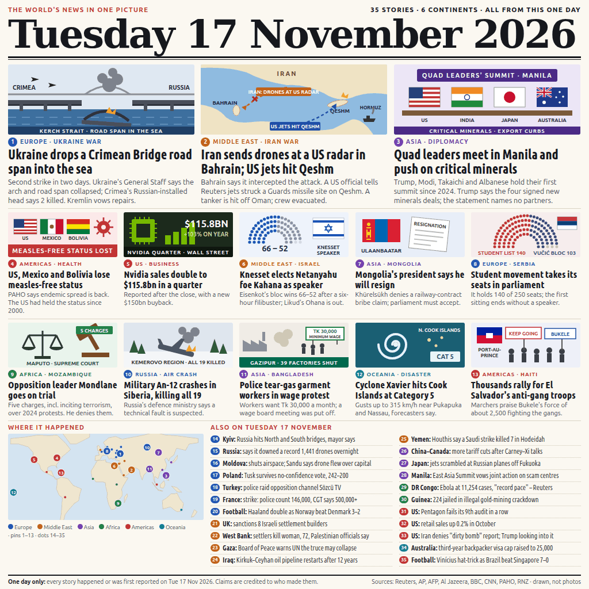

# news-image-20261117 — Tuesday 17 November 2026 in one picture

[](https://make.fun/c/news-image-20261117)
[](https://make.fun/c/news-image-20261117)
[](https://make.fun/c/news-image-20261117)

An entry to make.fun's [news-image-20261117](https://make.fun/c/news-image-20261117) competition: one image that
sums up the world's news of **Tuesday 17 November 2026** (35 stories, six continents, a map, every claim credited).



## How it works

- `entry.png` (1024×1024, 128-colour palette PNG, ~108 KB) is drawn ahead of time and kept in the repository.
- `main.ts` (Node 22, standard library only) copies it to `/output/entry.png`; no network, same bytes every run.
- `build/page.html` is the layout with hand-drawn SVG illustrations (no photos); `build/render.mjs` renders it
  with headless Chromium, and `build/pack.mjs` turns the render into a palette PNG with no dithering, keeping
  every colour the design names exact so text stays sharp.

```sh
mkdir -p out && MAKEFUN_OUTPUT_DIR=out node main.ts
```

## Sources

Every story happened, or was first reported, on Tuesday 17 November 2026 (any time zone). Claims are credited in
the image to whoever made them.

| # | Story (as shown) | Sources checked |
|---|---|---|
| 1 | Ukraine strikes Kerch (Crimean) Bridge for a 2nd day; General Staff says arch and road span collapsed; Aksyonov says 2 killed; Kremlin vows repairs | ABC News (AU), NBC News, PBS/AP, Kyiv Independent |
| 2 | IRGC says drones targeted US radar in Bahrain; Bahrain says it intercepted them; US official tells Reuters jets hit IRGC launch site on Qeshm; tanker hit off Oman, crew evacuated | Khaleej Times live blog (citing Reuters, AFP, UKMTO), Al Jazeera |
| 3 | Quad leaders' summit in Manila (Trump, Modi, Takaichi, Albanese); concern over export curbs; Trump says four signed minerals deals | Japan PM's Office summary, ANI, Al Jazeera |
| 4 | PAHO withdraws measles-elimination status of US, Mexico, Bolivia | ABC News, CNN, TIME, The Hill |
| 5 | Nvidia Q3 FY27 revenue $115.8bn (+103%), $150bn buyback, reported after the close | CNBC, Nvidia release (via StockTitan), Yahoo Finance live |
| 6 | Knesset elects Matan Kahana speaker 66–52, replacing Amir Ohana | Times of Israel, CNN, NBC News, ynet |
| 7 | Mongolian President Khürelsükh says he will resign over railway bribe claim, denies it | AP (via ABC News), Yahoo/AFP |
| 8 | Serbia's Student List MPs take seats (140 of 250); no speaker elected on day one | Reuters (via US News), Al Jazeera, Balkan Insight |
| 9 | Venâncio Mondlane's trial opens at Mozambique's Supreme Court on five charges | Club of Mozambique (Lusa) |
| 10 | Russian An-12 military transport crashes near Kemerovo; defence ministry says all 19 killed | Al Jazeera, NBC News, The Moscow Times |
| 11 | Bangladesh police fire tear gas at garment workers demanding Tk 30,000 minimum wage; 39 factories shut | Al Jazeera, Prothom Alo, Dhaka Tribune |
| 12 | Cyclone Xavier reaches Category 5 over the Northern Cook Islands, gusts up to 315 km/h | RNZ, Cook Islands News |
| 13 | Thousands rally in Haiti for El Salvador's anti-gang troops (about 2,500) | AP (via NBC News), Al Jazeera, France 24 |
| 14 | Russia strikes Kyiv's North and South bridges, Klitschko says | ABC News (AU), Kyiv Independent |
| 15 | Russia says it downed a record 1,441 drones | ABC News (AU), Russian Defence Ministry |
| 16 | Moldova closes airspace; Sandu says a Russian drone flew over Chișinău | Euronews, Reuters (via Yahoo) |
| 17 | Tusk government survives no-confidence vote 242–200 | Anadolu, Econotimes |
| 18 | Police raid Sözcü TV; trustee appointed | AP (via ABC News), Bloomberg, CPJ, Euronews |
| 19 | French public-sector strike: 146,000 (police) vs 500,000+ (CGT) | The Local France, Rio Times |
| 20 | Norway beat Denmark 3–2 (Haaland 2) in Nations League | ESPN, beIN Sports |
| 21 | UK sanctions eight Israeli settlement builders (and Tzav 9) | JTA, CBC, Jerusalem Post |
| 22 | Settlers kill a 72-year-old woman near Jericho, Palestinian officials say | Al Jazeera, Reuters (via Yahoo), Al-Monitor |
| 23 | Board of Peace report to UN warns Gaza truce may collapse | AP (via KIRO 7) |
| 24 | Iraq restarts Kirkuk–Ceyhan pipeline after 12 years (120,000 bpd) | Turkish Minute, Daily Sabah, TASS |
| 25 | Houthis say Saudi strike on a Hodeidah factory killed 7 | AP (via Foreign Exchanges roundup) |
| 26 | Canada and China agree further tariff cuts after Carney–Xi talks | France 24/AFP, Al Jazeera, CBC |
| 27 | Japan scrambles jets; says Russian planes entered airspace off Fukuoka | The Japan Times, Anadolu |
| 28 | East Asia Summit in Manila adopts statement against online scam centres | Backend News, The 420 |
| 29 | DR Congo Ebola: 11,254 cases, 5,505 deaths, "record pace" (Reuters) | Reuters (via Foreign Exchanges roundup) |
| 30 | Guinea court jails 224 over illegal gold mining | AP (via CP24), allAfrica |
| 31 | Pentagon fails its 9th audit in a row | Reuters (via Arab News), Breaking Defense |
| 32 | US retail sales +0.2% in October | Yahoo Finance live |
| 33 | Iran denies "dirty bomb" report; Trump says he is looking into it | Khaleej Times live blog, BBC (via Foreign Exchanges) |
| 34 | Australia raises third-year working-holiday visa cap to 25,000 | Ethos Migration, Vinetur, ABC (via reports) |
| 35 | Brazil beat Singapore 7–0, Vinícius hat-trick | Goal.com, Yahoo Sports/AFP, VAVEL |

## License

MIT — see [LICENSE](LICENSE).
